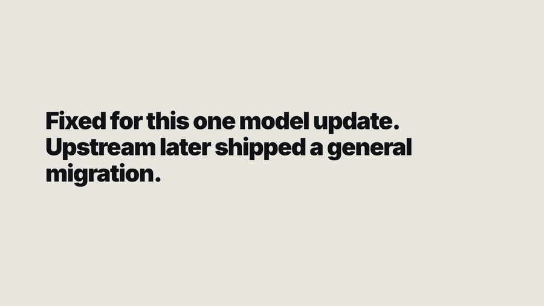

# Returner

[](https://github.com/fexx301/returner/actions/workflows/test.yml) [](https://github.com/fexx301/returner/actions/workflows/returner.yml) [](LICENSE)

**Release checks for the people who come back.** · **[Try it live in your browser →](https://fexx301.github.io/returner/try/)** · **[See every closed loop on one page →](https://fexx301.github.io/returner/)**

[](https://youtu.be/iPpaQIgh1KI?t=173)

<sub>One real, uninterrupted 20-minute run (PKI Consortium #148), condensed to 15 seconds (about 81×) from its timestamped terminal output. Click for the narrated walkthrough, which shows it at 50×.</sub>

Browser tests usually start with an empty profile, so they only ever meet new users. The bugs that hurt returning users never show up there. A renamed storage key, a changed data model or a migration that forgets old saves can each lose or break the work people already have.

Returner rehearses a release as both users. It uses real Chrome, driven by [Kane CLI](https://www.testmuai.com/docs/kane-cli-introduction).

- **A returning user with a real history.** Kane saves work on the previous build, and Returner keeps that browser profile as an untouched snapshot.
- **A side-by-side verdict.** On the new build at the same address, a new user and the returning user run the same task.
- **A closed repair loop.** Kane's failure goes to Codex or Claude Code. The agent patches a disposable copy, Returner rebuilds it, and Kane replays the returning user from the same snapshot until it passes or the attempts run out. The agent never grades its own fix.
- **Runs locally or in CI.** It's one Node CLI with zero package dependencies, and it also ships as a GitHub Action.

## Try it

Needs Node 22+, Chrome and a signed-in [Kane CLI](https://www.testmuai.com/docs/kane-cli-introduction). The two commands below take about 7 minutes and about 120 Kane credits in total.

```sh
git clone https://github.com/fexx301/returner && cd returner
npm run demo   # ~3.5 min, ~60 credits. Fieldnotes v1 → v2: the new user passes, the returning user fails (exit 1)
node src/returner.mjs --replay .returner/run-XXXXXX --new examples/draft/v2
               # ~3.5 min, ~60 credits. Paste the run folder that npm run demo printed after "Evidence:".
               # Same port, marker and saved profile; the repaired v2 passes (exit 0)
```

`npm run demo` also prints a replay command pointing at `examples/draft/v2-broken`, for when you repair that copy in place. To have an agent do the repair, run `npm run demo:repair` (needs a signed-in Codex CLI; it runs several Kane checks, so it takes longer and costs more).

Then open a real regression, [PKI Consortium #148: before](https://fexx301.github.io/returner/evidence/pkimm-1.0.0-to-1.1.0/before/report.html) and [after the repair](https://fexx301.github.io/returner/evidence/pkimm-1.0.0-to-1.1.0/after/report.html).

## Watch the walkthrough

**[▶ Watch the 4-minute walkthrough on YouTube](https://youtu.be/iPpaQIgh1KI)**. It covers the planted bug, two real regressions (PKI Consortium and Rackula), an uninterrupted Codex run at 50× and the GitHub Action on a real runner. Jump straight to the closed loop: [Kane's finding → Codex → replay (1:22)](https://youtu.be/iPpaQIgh1KI?t=82) · [an uninterrupted recorded run at 50× (2:53)](https://youtu.be/iPpaQIgh1KI?t=173).

## Proof

| Run | New user | Returning user | Evidence |
| --- | --- | --- | --- |
| **Real regression:** PKI Consortium self-assessment, model 1.0.0 → 1.1.0 ([issue #148](https://github.com/pkic/self-assessment/issues/148)) | Pass | **Fail**: blank page, the app crashes while loading old saves | [report](https://fexx301.github.io/returner/evidence/pkimm-1.0.0-to-1.1.0/before/report.html) |
| ↳ repaired by **Claude Code**, replayed from the same v1 profile | Pass | **Pass**: both names, all three answers and the new Cryptography category | [patch](evidence/pkimm-1.0.0-to-1.1.0/repair.diff) · [report](https://fexx301.github.io/returner/evidence/pkimm-1.0.0-to-1.1.0/after/report.html) |
| ↳ one uninterrupted recorded run with **Codex** (20 min 6 s, fixed on attempt 1) | Pass | Fail → **Pass** | [patch](evidence/pkimm-1.0.0-to-1.1.0/codex-recorded-run/repair.diff) · [run](evidence/pkimm-1.0.0-to-1.1.0/codex-recorded-run/) |
| **Real regression caught before release:** Rackula v0.6.16 → v0.7.0 development build ([issue #935](https://github.com/RackulaLives/Rackula/issues/935)) | Pass | **Fail**: the saved rack is gone and the app throws on load → **Pass** after Codex's repair | [before](https://fexx301.github.io/returner/evidence/rackula-0.6.16-to-0.7.0-dev/before/report.html) · [patch](evidence/rackula-0.6.16-to-0.7.0-dev/repair.diff) · [after](https://fexx301.github.io/returner/evidence/rackula-0.6.16-to-0.7.0-dev/after/report.html) |
| **GitHub Actions** on `ubuntu-latest` | Fieldnotes repaired: pass | PKIMM 1.1.0: regression caught | [workflow run](https://github.com/fexx301/returner/actions/runs/44353094616) |
| **Clean upgrade:** DeckMark v2.5.3 → v2.5.4, unmodified upstream builds | Pass | Pass: original note opened, edited and reloaded | [report](https://fexx301.github.io/returner/evidence/deckmark-2.5.3-to-2.5.4/report.html) |
| **Fixture:** Fieldnotes, storage key deliberately renamed in v2 | Pass | Fail → **Pass** after Codex repair | [before](https://fexx301.github.io/returner/evidence/fieldnotes-before/report.html) · [after](https://fexx301.github.io/returner/evidence/fieldnotes-after/report.html) · [one command](evidence/one-command-repair.json) |

Every browser observation comes from Kane. Report links open the rendered `report.html` (objectives, verdicts and Kane's step logs); the JSON sits next to each one. Method and disclosures: [PKIMM](evidence/pkimm-1.0.0-to-1.1.0/README.md), [Rackula](evidence/rackula-0.6.16-to-0.7.0-dev/README.md).

## How it works

1. **Seed yesterday.** Returner serves the old build at a fixed localhost address. Kane creates work containing a random marker in a fresh Chrome profile, then verifies it after a reload. Returner keeps the closed profile as the untouched snapshot.
2. **Ship today.** The new build is served at the same address, so the browser's storage still belongs to the same origin.
3. **New user (control).** A fresh profile performs the same task.
4. **Returning user (the check).** A copy of the snapshot opens the new build. Kane must find the original marker, and it fails rather than recreating anything that's missing.
5. **Repair and replay.** On a failure, `repair.mjs` hands the coding agent Kane's verdict, its steps and the browser console errors from Kane's evidence pack (such as Rackula's startup crash, which Kane's summary missed). It then rebuilds and replays step 4 from the same snapshot.
6. **No faked fixes.** Returner never puts the run's marker in the agent's prompt: it is redacted from Kane's findings, earlier attempts and build output. A passing replay must also survive a fresh rehearsal with brand-new saved work, so a fix that hardcodes one user's saved data is rejected and sent back to the agent. `npm test` includes a cheating agent that reads the hidden marker from disk and is still rejected, through both `repair.mjs` and `npm run demo:repair`. The fresh rehearsal changes the marker, not the rest of the task (see Limitations).

## Quick start

Requires Node 22+, Google Chrome and Kane CLI. Each Kane run uses TestMu credits.

```sh
git clone https://github.com/fexx301/returner && cd returner
npm install -g @testmuai/kane-cli && kane-cli login
```

**Rehearse your own release** (two static builds with a root `index.html`, or two running apps by URL):

```sh
node src/returner.mjs --old ./v1 --new ./v2 --promise "My draft survives the release"
# Or proxy two running servers through Returner's single localhost origin:
node src/returner.mjs --old http://127.0.0.1:4001 --new http://127.0.0.1:4002 --promise "My draft survives the release"
```

Or skip the clone and run it straight from GitHub:

```sh
npx github:fexx301/returner --old ./v1 --new ./v2 --promise "My draft survives the release"
```

The default task creates and reopens a draft with a title and body. For other apps, describe the task with `--seed` (create the saved work) and `--check` (what a returning user must still find). Returner fills in a fresh `{title}` and `{body}` marker on every run.

**Repair with a coding agent** (needs a signed-in Codex CLI or Claude Code):

```sh
node src/repair.mjs --old ./v1-build --source ./v2-source --build "npm run build" --serve dist \
  --promise "My draft survives the release" --agent codex --attempts 3
```

**Try the included examples:**

| Command | What it shows |
| --- | --- |
| `npm run demo` | Fieldnotes: the new user passes and the returning user fails (exit 1) |
| `npm run demo:repair` | Fieldnotes: Codex repairs it, and the replay passes |
| `examples/pkimm/prepare.sh && examples/pkimm/run.sh codex` | The real PKI Consortium regression, fetched at pinned upstream revisions, repaired and replayed |
| `examples/rackula/prepare.sh && examples/rackula/run.sh codex` | Rackula's v0.6.x autosave regression, built from pinned commits, repaired and replayed |
| `examples/server/run.sh codex` | Quillpad: a server-rendered Node app proxied at one origin (`--start`), repaired from its 500 stack trace |

**Add it to CI:**

```yaml
- uses: fexx301/returner@main
  with:
    old: previous-build   # build the previous release here in an earlier step
    new: dist
    promise: My draft survives the release
    testmu-username: ${{ secrets.LT_USERNAME }}
    testmu-access-key: ${{ secrets.LT_ACCESS_KEY }}
```

The action installs a pinned kane-cli and runs headless Chrome. It posts the verdict table to the job summary and uploads `report.html` and `report.json`, never the browser profiles. The job fails on a regression or an inconclusive run. [`returner.yml`](.github/workflows/returner.yml) is a manual demo that produces both outcomes.

## Reference

| Exit code | Meaning |
| --- | --- |
| `0` | Every required Kane check passed |
| `1` | A release check failed its assertion (the returning-user regression) |
| `2` | Not enough evidence: a failed baseline, an interrupted runner, an occupied replay port or a missing document request |

- `returner.mjs --replay <run-dir> --new <build>`: reruns the new-user and returning-user checks from a saved baseline, with the same port, marker, objective and untouched v1 profile. A failed rehearsal prints the exact replay command.
- `repair.mjs` writes `attempt-N.json` per attempt and `repair.diff` on success. `--reference <file>` gives the agent read-only material from the previous release, and `--note` adds context.
- Reports go to `report.json` and `report.html` in each run directory. Keep run directories local, because they hold browser profiles, and share only the reports.

## Limitations

- **Localhost origin only; no multi-tenant backend state snapshots.** `--old` and `--new` accept static builds or running app URLs (proxied through one localhost origin so cookies and browser storage carry over; `repair.mjs --start` starts and stops the candidate server per check). Database migrations and third-party OAuth sign-in flows aren't managed by Returner.
- **It tests browser-side state:** whatever the Chrome profile carries, such as localStorage, IndexedDB and cookies.
- **Kane credits:** the recorded runs used about 5–95 credits per Kane run. Longer objectives cost more.
- **Kane verdicts can be inconclusive.** Returner reports exit 2 instead of guessing. The first PKIMM attempt in the Actions run was inconclusive, and the rerun reproduced the regression.
- **Recorded runs predate later loop hardening.** Marker redaction and fresh-rehearsal confirmation were added on Nov 20 (`npm run demo:repair` uses them from Nov 21), and automatic console-error extraction was added on Nov 22. The recorded repairs ran before those additions; their patches contain no marker strings (check the diffs) and their reports were backfilled from the saved Kane packs.
- **Fresh rehearsals vary the marker, not the whole task.** The PKIMM objectives always save the same three answer levels, so a patch that hard-wired those exact levels, rather than the marker, would not be caught by the fresh rehearsal.
- **The repairs are specific.** The PKIMM repairs map the categories for this one model change. Upstream's v2.0.0 later shipped a general migration.
- **Service workers:** a navigation served entirely from a service worker can come back inconclusive, because Returner also checks that its server received a document request.

## Development

`npm test` runs the CLI and repair-loop contract tests with stand-in Kane and agent runners. Live Chrome runs are recorded separately in `evidence/`.
